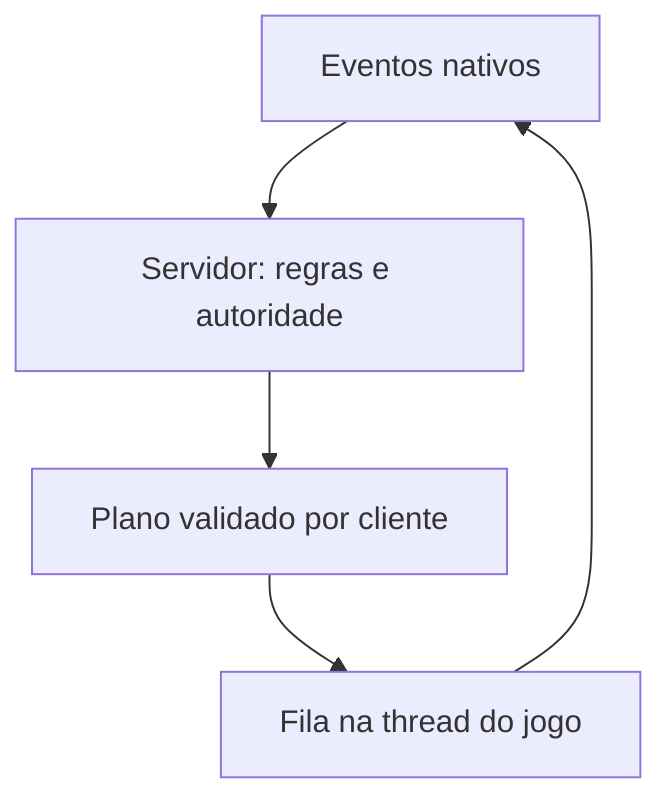

# Backend nativo: contrato e bloqueios

## Adaptador experimental de presença

Preview 2 corrige o receptor do callback: `PlayerDamage` contém o ator dono em `this + 0x18`; o receptor não é o próprio Player. Agora exige heartbeat da thread do jogo e confirma modelo/animação antes de anunciar criação. Acrescenta convergência limitada de vida de inimigos do mapa no protocolo 3, sem copiar vida/inventário de jogadores. A Gen1 completa abaixo continua bloqueada; IA por proximidade, PvP e coleta ainda não estão integrados.

O código em [`native/`](../../native/README.md) implementa a primeira fila de operações nativas no ciclo de atualização do jogador, com criação assíncrona de um ator separado, referência retida, transformação/animação e remoção. Os recursos são gerados privadamente a partir da instalação do usuário. O build inclui o gerador modificado e exige reconstrução da biblioteca local.

Esse caminho usa agora o protocolo 3 para presença e convergência limitada de vida dos inimigos do mapa. Não atende ao contrato completo abaixo: coleta, PvP e autoridade de IA permanecem pendentes. `hm_caps` mantém as capacidades Gen1 desativadas. A máquina de estados e a preservação da CPU foram testadas com memória sintética; a aparência do ator ainda exige validação no jogo.

## Pesquisa sobre o runtime

Referência fixada: [Revivedx/SavageWindRecomp, commit 740b180](https://github.com/Revivedx/SavageWindRecomp/tree/740b18025fe11ba03c117dbb56668db304b5043e), versão 0.5.3-alpha.5.

- [`runtime/control.h`](https://github.com/Revivedx/SavageWindRecomp/blob/740b18025fe11ba03c117dbb56668db304b5043e/runtime/control.h) e [`runtime/control.c`](https://github.com/Revivedx/SavageWindRecomp/blob/740b18025fe11ba03c117dbb56668db304b5043e/runtime/control.c): comandos do socket local são executados na fronteira de apresentação. Não é uma garantia de execução na thread que atualiza atores. A entrada tem limite de 4096 bytes; o cliente de controle do launcher é ainda mais restrito. Não enviar um snapshot Gen1 inteiro como comando textual.
- [`runtime/control_game.c`](https://github.com/Revivedx/SavageWindRecomp/blob/740b18025fe11ba03c117dbb56668db304b5043e/runtime/control_game.c): posição, câmera e ferramentas de sandbox existentes. Não oferece criação de Link remoto, colisão, interceptação de dano ou troca de alvo da IA.
- [`runtime/items.c`](https://github.com/Revivedx/SavageWindRecomp/blob/740b18025fe11ba03c117dbb56668db304b5043e/runtime/items.c): `give` entrega itens pela bolsa; não é uma API genérica para criar atores. O runtime já enfileira operações para `rt_item_tick`, na thread do jogo.
- [`tools/patches.py`](https://github.com/Revivedx/SavageWindRecomp/blob/740b18025fe11ba03c117dbb56668db304b5043e/tools/patches.py) e [`tools/game_sites.py`](https://github.com/Revivedx/SavageWindRecomp/blob/740b18025fe11ba03c117dbb56668db304b5043e/tools/game_sites.py): identificação e patches de pontos da versão correta. Há pontos de bolsa, vida e referências a atores; isso não equivale a uma função validada de criação de um segundo jogador ou de substituição do alvo de IA.
- [`runtime/gamebuild.c`](https://github.com/Revivedx/SavageWindRecomp/blob/740b18025fe11ba03c117dbb56668db304b5043e/runtime/gamebuild.c): compila módulos a partir da extração do jogo. O código C temporário não é um artefato estável que se possa presumir na instalação do usuário. O módulo NSO original é a entrada para estudar novas funções.
- [`tools/nso.py`](https://github.com/Revivedx/SavageWindRecomp/blob/740b18025fe11ba03c117dbb56668db304b5043e/tools/nso.py): cabeçalho NSO0 e Build ID em `0x40:0x60`, usados pelo diagnóstico somente para identificação.

Não foram encontrados endpoints nativos capazes de cumprir o pedido no runtime oficial inspecionado. Nenhum offset novo de ator ou IA foi inventado, e nenhum binário do jogo é incluído nesta branch.

## Fluxo exigido

`launcher/internal/nativebridge` define um plano validado e uma interface de backend. **Ainda não existe implementação dessa interface para BOTW.** `Gate` exige capacidades reais antes de chamar `ApplyOnGameThread`; aceita o backend de teste somente quando a simulação é habilitada explicitamente.

O contrato exige:

1. **Identificar build e mundo.** Confirmar o módulo esperado, resolver pontos por assinatura validada e abortar se qualquer assinatura/ABI falhar. Interior, mundo aberto, carregamento e descarte de atores precisam de identidade estável.
2. **Criar somente o Link remoto.** O Link local continua sendo o jogador nativo normal. Criar proxy remoto com modelo, animação, equipamento e colisão reais, sem clonar as rotinas de câmera, entrada, auto-save ou inventário do jogador local. Destruir somente atores criados/gerenciados pelo HyruleM ao sair/trocar de mapa.
3. **Inicializar o estado pessoal sem limpá-lo.** Ler vida e subconjunto gerenciado do inventário no primeiro ingresso; enviar `seed` uma vez. Um snapshot `initialized=false` não significa bolsa vazia nem HP zero para gravar no jogo. Na reconexão, usar o estado já aceito pelo servidor. Conservar os IDs locais estáveis durante a sessão.
4. **Interceptar ações antes da alteração.** Eventos de coleta, descarte, equipamento e acerto produzem intenções, não comandos arbitrários de memória. Aguardar aceite e reconciliar pelo snapshot. Não aplicar dano/coleta nativamente e repeti-los ao receber o servidor. Em timeout, consultar estado autoritativo; não reenviar com outro ID como se fosse uma ação nova.
5. **Aplicar vida e bolsa apenas no destinatário.** `Plan.Personal` pertence sempre a `SelfID`. O modelo remoto recebe somente aparência, animação e condição pública. Atualizar só os itens gerenciados, preservando slots/categorias fora do catálogo e o save original.
6. **Uma IA por criatura.** `EnemyPlan.SimulateAI=true` somente para o dono vigente. Os demais clientes reproduzem a pose e suspendem sua cópia da IA e dano. Mapear `Target` para o ator local ou remoto correspondente e forçar essa referência, mesmo quando a IA escolheria outro alvo. Ao mudar `epoch`, invalidar eventos anteriores e cancelar ataques pendentes. A ausência de alvo suspende a simulação compartilhada.
7. **Operações de jogo na thread certa.** A rede deposita uma cópia limitada do plano numa fila. A atualização do jogo valida identidades/referências e efetua o plano completo. Nenhuma manipulação de ator diretamente do socket ou da thread de apresentação. Nunca reaproveitar um endereço de ator após unload; IDs e referências precisam de geração.
8. **Falhar sem aplicar metade do plano.** Verificar espaço, referências e recursos antes de alterar o estado. Se o backend não puder concluir com segurança, manter o último estado consistente, pausar a integração e devolver erro. Não afirmar capacidades com callbacks vazios.

## Negociação proposta

O diagnóstico procura `hm_caps` no controle local. Esse comando **não existe no runtime oficial**; deverá ser implementado junto com o backend e retornar os campos de `gen1.Capabilities` em `data`.

Requisitos: ABI 1, `runtime=SavageWind-HyruleM`, `game_version=1.9.0`, `simulated=false`, e todas as capacidades `native_actors`, `animation`, `collision`, `personal_vitals`, `personal_inventory`, `pickup_hook`, `damage_hook`, `enemy_authority`, `enemy_target`, `world_identity` verdadeiras. Esses campos são uma verificação de compatibilidade; não são atestado criptográfico nem antitrapaça.

O backend pode desenvolver cada capacidade separadamente, mas o servidor Gen1 não admite uma sessão como nativa completa antes de todas existirem. A integração ao menu vem depois dessa confirmação, sem converter o avatar externo em uma alegação de ator real.

## Ordem de validação no jogo

1. Criar/destruir um proxy Link parado em Hateno; conferir unload e recarga sem referências inválidas.
2. Dois processos com movimentação, animação, colisão e equipamento distintos, na mesma máquina e depois em LAN/Radmin.
3. Coleta simultânea de uma única arma, descarte e transferência; nenhuma duplicação e nenhuma alteração no inventário do outro.
4. Dano ambiental e ataque entre Links; vida da vítima e durabilidade do atacante, sem dano duplicado.
5. Um Bokoblin com dois jogadores; cruzar distâncias para trocar o alvo, inclusive no meio de um ataque. Desconectar o dono durante a troca e rejeitar pacotes antigos.
6. Morte, menus, load, outro mundo e encerramento: nenhuma cópia da IA continua causando dano sem autoridade.

Essas validações estão pendentes. Testes de lógica e compilação não as substituem.
